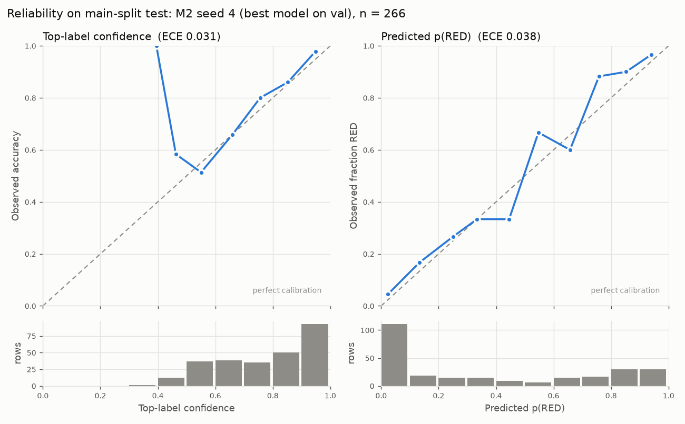

# Triage classifier: rules vs. learned models

Generated by `backend/triage/model/evaluate.py` from this template (`model/report_template.md`);
the tables are filled in from `model/artifacts/results.json`. Data: `backend/triage/data/` v1.1
(adjudicated labels, `data/ADJUDICATION.md`).

## Default mode changed to hybrid (2026-11-12)

`TRIAGE_MODE` unset now means **hybrid** (v2: M2 `m2_main_v2_it3_seed0` + temperature override +
self-harm override, most serious level wins). `TRIAGE_MODE=rules` gives the keyword engine exactly
as before; `TRIAGE_MODEL_VERSION=v1` still selects the v1 model and thresholds. Unknown
`TRIAGE_MODE` values use the default (hybrid) and log a warning. The shipped M2 folder (~88 MB,
largest file 90,864,192 bytes) is committed in git (no LFS), so a fresh clone loads it with no
training; other seeds, v1 weights and caches stay uncommitted. If the folder is missing or fails to
load, one stderr WARNING names it and M1 is used; `main.py` loads the classifier at startup so the
warning appears when the server starts. Pinned in `requirements.txt`: torch 2.14.0 (CPU),
sentence-transformers 6.0.1, setfit 1.2.0, transformers 5.17.0, scikit-learn 1.9.1.

Sections below that say "the default, rules" describe the configuration when they were measured.

**Test suites with the new default** (SMTP and DOCTOR_ALERT variables cleared, temporary patient
database; same code, run once with `TRIAGE_MODE` unset and once with `TRIAGE_MODE=rules`):

| suite | hybrid (default) | rules |
|---|---|---|
| `test_multi_agent_orchestration.py` | 4/5 | 5/5 |
| `test_nutrition_wellbeing_agents.py` | 6/9 | 9/9 |
| `test_doctor_alert.py` | 2 check failures | all checks passed |
| `test_phase4_agents.py` | 3 check failures | all checks passed |
| `test_fallback_procedure_isolation.py` | 5/10 | 5/10 (same 5; `ChatAgent._generate_smart_reply` signature) |
| `test_specialized_assigned.py` | 1/4 | 1/4 (same 3) |
| `test_phase3_rag.py` | 4 check failures | same 4 (reindex returns `None`) |
| `test_pain_symptoms_agent.py`, `test_recovery_progress_agent.py`, `test_rehabilitation_agent.py`, `test_symptom_assessment_agent.py`, `test_medication_schedule.py` | 79/79 | 79/79 |
| `test_medication_proactive.py` | 21/21 | 21/21 |
| `test_phase2_intent.py` | all checks passed | all checks passed |
| `triage/test_overrides.py`, `triage/test_classifier_triage.py` | 153/153 | 153/153 |

Every hybrid-only failure is classifier over-triage: six messages that rules call GREEN or YELLOW
and the tests expect YELLOW/GREEN handling get a classifier RED (no override fired). Four of the
six are above t_alert (0.684) and would email the doctor.

| message (test) | rules | hybrid p(RED) | doctor email |
|---|---|---|---|
| "My knee is more swollen today and hurts." (phase4) | YELLOW | 0.809 | yes |
| "I cannot keep fluids down and I am hardly urinating." (nutrition) | GREEN | 0.782 | yes |
| "Since I didn't take my medicine yesterday, my knee wound is worse" (orchestration, Finding V7) | GREEN | 0.756 | yes |
| "I feel hopeless and cannot function." (wellbeing) | GREEN | 0.753 | yes |
| "I feel scared to move my leg." (wellbeing) | GREEN | 0.601 | no (suppressed) |
| "My wound looks a bit red today." (doctor_alert G) | YELLOW | 0.477 | no (suppressed) |

The tests were not changed.

## Set-up

- **Task.** One patient message (text only, no temperature field, no history) -> RED / YELLOW / GREEN.
- **Data.** Main split `data/splits/` (train 1,253 / val 276 / test 266, every scenario in every
  split); challenge set `data/challenge.jsonl` (150 rows, written after the splits); unseen-scenario
  split `data/splits_unseen_scenario/` (val and test scenarios never in train).
- **Discipline.** Every model choice, hyper-parameter and threshold was chosen on val
  (`model/artifacts/selection.json`). Test, challenge and the unseen-scenario test were predicted
  once and read only by `evaluate.py`. Seeds fixed (LR: deterministic lbfgs; SetFit seeds 0-4).
- **Contenders.**
  - **B0** `safety_triage.py` at 6e63cbf, **B1** at 9f60dfe (current main, Rishi's version), both
    imported from `git show` into a temp module and called as `evaluate(text)` with no temperature.
  - **M1** frozen all-MiniLM-L6-v2 embeddings (normalised) + multinomial logistic regression,
    `class_weight="balanced"`, C from a 13-point log grid 1e-3..1e3 by val macro F1.
  - **M2** SetFit on all-MiniLM-L6-v2 (contrastive fine-tuning + logistic-regression head; batch 32,
    1 epoch, body lr 2e-5, max_seq_length 64; the longest message is 47 tokens). `num_iterations`
    in {1, 3} was chosen on the **main split's val with seed 0 only**, and the same value was
    **reused for the unseen-scenario split** without re-tuning (CPU time). Seeds 0-4 on the main
    split and seeds 0-2 on the unseen-scenario split, reported as mean ± sd; runs were strictly
    sequential (`model/artifacts/train.log`). The "shipped" seed is the one with the best val
    macro F1.
  - **H1** = max(B1, best model): the more urgent of the rule level and the model level. The best
    model is the one with the higher val macro F1 (M2 = mean over seeds).
- **Decision rules** (models only).
  - *argmax*.
  - *thresholded*: RED if p(RED) >= t_red, chosen on val as the highest threshold with val RED
    recall >= 0.95; otherwise YELLOW if p(RED) + p(YELLOW) >= t_yel, chosen on val (t_red fixed) as
    the highest threshold with >= 90% of YELLOW-labelled val rows **not** called GREEN (predicted
    YELLOW or RED); otherwise GREEN. This is how I read "GREEN-labelled YELLOWs are found at >= 0.90
    recall": the target is that YELLOW messages are not missed to GREEN.
- **CIs** are Wilson 95% intervals on RED recall. With 104 RED rows in test a recall of 0.95 has an
  interval of roughly +/- 0.04; with 58 RED challenge rows roughly +/- 0.06.

Choices made on val (`model/artifacts/selection.json`). The unseen-scenario rows reuse the
num_iterations chosen on the main split, as the tuning column shows.

| split | model | choice (val) | t_red | t_yel | val RED recall (thr.) | val YELLOW found (thr.) | val macro F1 (argmax) |
|---|---|---|---:|---:|---:|---:|---:|
| main | M1 | C = 3.16228 | 0.233 | 0.576 | 0.951 | 0.910 | 0.767 |
| main | M2 seed 0 | num_iterations = 3 | 0.195 | 0.205 | 0.951 | 0.910 | 0.772 |
| main | M2 seed 1 | num_iterations = 3 | 0.148 | 0.229 | 0.951 | 0.910 | 0.752 |
| main | M2 seed 2 | num_iterations = 3 | 0.232 | 0.250 | 0.951 | 0.910 | 0.775 |
| main | M2 seed 3 | num_iterations = 3 | 0.238 | 0.232 | 0.951 | 0.910 | 0.779 |
| main | M2 seed 4 (shipped) | num_iterations = 3 | 0.217 | 0.237 | 0.951 | 0.910 | 0.781 |
| main | best model | M2 | | | | | M2 num_iterations tuning (seed 0, val macro F1): 1: 0.754, 3: 0.772 |
| unseen | M1 | C = 3.16228 | 0.185 | 0.485 | 0.954 | 0.903 | 0.706 |
| unseen | M2 seed 0 (shipped) | num_iterations = 3 | 0.097 | 0.172 | 0.954 | 0.903 | 0.741 |
| unseen | M2 seed 1 | num_iterations = 3 | 0.105 | 0.163 | 0.954 | 0.903 | 0.718 |
| unseen | M2 seed 2 | num_iterations = 3 | 0.124 | 0.176 | 0.954 | 0.903 | 0.737 |
| unseen | best model | M2 | | | | | M2 num_iterations tuning (seed 0, val macro F1): 1: 0.754, 3: 0.772 |

## Headline (main split test and challenge set)

| contender | test RED recall | test 95% CI | challenge RED recall | challenge 95% CI | test RED->GREEN | challenge RED->GREEN | test macro F1 | challenge macro F1 |
|---|---:|---|---:|---|---:|---:|---:|---:|
| B0 | 0.096 | 0.053-0.168 | 0.103 | 0.048-0.208 | 83 | 47 | 0.311 | 0.288 |
| B1 | 0.192 | 0.128-0.278 | 0.241 | 0.150-0.365 | 74 | 39 | 0.357 | 0.333 |
| M1 argmax | 0.779 | 0.690-0.848 | 0.914 | 0.814-0.963 | 5 | 0 | 0.761 | 0.783 |
| M1 thresholded | 0.885 | 0.809-0.933 | 0.966 | 0.883-0.990 | 2 | 0 | 0.689 | 0.722 |
| M2 argmax | 0.815 ± 0.008 | seeds' CIs span 0.722-0.888 | 0.907 ± 0.009 | seeds' CIs span 0.792-0.963 | 2.2 ± 0.4 | 0.0 ± 0.0 | 0.769 ± 0.007 | 0.720 ± 0.007 |
| M2 thresholded | 0.927 ± 0.005 | seeds' CIs span 0.856-0.967 | 0.979 ± 0.014 | seeds' CIs span 0.883-1.000 | 1.4 ± 0.5 | 0.0 ± 0.0 | 0.694 ± 0.016 | 0.631 ± 0.021 |
| H1 argmax | 0.837 | 0.754-0.895 | 0.931 | 0.836-0.973 | 2 | 0 | 0.752 | 0.649 |
| H1 thresholded | 0.923 | 0.856-0.961 | 0.966 | 0.883-0.990 | 2 | 0 | 0.655 | 0.539 |

test n = 266 (RED 104); challenge n = 150 (RED 58). H1 = max(B1, M2 (seed 4)). M2 rows: mean ± sd over 5 seeds.

**Finding 1: the rule engines are not a usable baseline for free-text triage.** On the main test
split B1 catches 20 of 104 RED messages (recall 0.192, CI 0.128-0.278) and sends 74 of them to
GREEN; B0 catches 10. On the challenge set B1 catches 14 of 58. The rules match fixed phrases and
read temperature only from a numeric argument, which a text-only message never supplies, so every
"fever of 39"-type message falls through. B1 is better than B0 (self-harm patterns, co-occurrence
rules) but the gap to any learned model is 60 or more points of RED recall.

**Finding 2: the learned models reach 0.8-0.9 RED recall on test, and the thresholded rule buys about
10 points of it.** M2 (SetFit) with argmax: 0.815 ± 0.008; with the val-chosen thresholds:
0.927 ± 0.005, cutting RED->GREEN from 2.2 to 1.4 per 104. The price is precision and over-triage:
RED precision falls from 0.83 to 0.71, macro F1 from 0.77 to 0.69, and about half the YELLOW
messages are called RED (32 of 62). M1 behaves the same way, 0.779 -> 0.885. Neither model hits the
0.95 RED-recall target on test that the thresholds were set to on val: M2's per-seed intervals
include 0.95, M1's (0.809-0.933) do not.

**Finding 3: M1 and M2 are close; the choice of M2 rests on a 0.005 val margin.** Val macro F1 was
0.767 (M1) vs 0.772 (M2 mean of 5 seeds). On test M2 is ahead on RED recall (thresholded 0.927 vs
0.885), but on the challenge set M1 has the higher macro F1 (argmax 0.783 vs 0.720) and identical
RED->GREEN (0). Most differences between M1 and M2 are inside the confidence intervals. Seed-to-seed
spread of M2 is small (sd <= 0.01 on RED recall).

**Finding 4: H1 = max(B1, M2) adds nothing on the RED side and costs precision.** B1 catches **no**
RED message that the shipped M2 (seed 4, thresholded) misses, on test, on the challenge set or on
the unseen-scenario test. Every level H1 raises is a non-RED message: on test B1 adds 7 false REDs
and raises 15 non-RED rows; on the challenge set it adds 12 false REDs and macro F1 drops from 0.63
(M2 thresholded, mean of seeds) to 0.54. The two RED->GREEN misses left on main test are the same for M2 and H1:
`HIGH_FEVER-048` "Is 38.5 the cut-off? Because that's what I've got right now." and `MOOD_SLEEP-013`
"Some nights I think everyone would be better off without me. I've been looking at my tablets and
thinking about it." The second is a self-harm disclosure that B1's self-harm list does not match
("better off dead" is listed, "better off without me" is not).

## Main-split test: all metrics

| contender | RED recall | 95% CI (Wilson) | RED precision | macro F1 | RED->GREEN | RED->YELLOW | GREEN->RED | YELLOW->GREEN |
|---|---:|---|---:|---:|---:|---:|---:|---:|
| B0 | 0.096 | 0.053-0.168 | 0.667 | 0.311 | 83 | 11 | 2 | 50 |
| B1 | 0.192 | 0.128-0.278 | 0.667 | 0.357 | 74 | 10 | 5 | 48 |
| M1 argmax | 0.779 | 0.690-0.848 | 0.835 | 0.761 | 5 | 18 | 6 | 8 |
| M1 thresholded | 0.885 | 0.809-0.933 | 0.667 | 0.689 | 2 | 10 | 15 | 5 |
| M2 argmax | 0.815 ± 0.008 | seeds' CIs span 0.722-0.888 | 0.831 ± 0.011 | 0.769 ± 0.007 | 2.2 ± 0.4 | 17.0 ± 0.7 | 3.4 ± 0.5 | 10.8 ± 0.8 |
| M2 thresholded | 0.927 ± 0.005 | seeds' CIs span 0.856-0.967 | 0.709 ± 0.019 | 0.694 ± 0.016 | 1.4 ± 0.5 | 6.2 ± 0.4 | 7.6 ± 1.5 | 4.6 ± 1.3 |
| H1 argmax | 0.837 | 0.754-0.895 | 0.777 | 0.752 | 2 | 15 | 7 | 7 |
| H1 thresholded | 0.923 | 0.856-0.961 | 0.671 | 0.655 | 2 | 6 | 10 | 2 |

n = 266, RED = 104. M2 rows: mean ± sd over seeds (5 main, 3 unseen-scenario; CI column: range of the per-seed Wilson intervals).

**B0**

| true \ pred | RED | YELLOW | GREEN |
|---|---:|---:|---:|
| RED | 10 | 11 | 83 |
| YELLOW | 3 | 9 | 50 |
| GREEN | 2 | 7 | 91 |

**B1**

| true \ pred | RED | YELLOW | GREEN |
|---|---:|---:|---:|
| RED | 20 | 10 | 74 |
| YELLOW | 5 | 9 | 48 |
| GREEN | 5 | 7 | 88 |

**M1 argmax**

| true \ pred | RED | YELLOW | GREEN |
|---|---:|---:|---:|
| RED | 81 | 18 | 5 |
| YELLOW | 10 | 44 | 8 |
| GREEN | 6 | 13 | 81 |

**M1 thresholded**

| true \ pred | RED | YELLOW | GREEN |
|---|---:|---:|---:|
| RED | 92 | 10 | 2 |
| YELLOW | 31 | 26 | 5 |
| GREEN | 15 | 10 | 75 |

**M2 argmax (mean of 5 seeds)**

| true \ pred | RED | YELLOW | GREEN |
|---|---:|---:|---:|
| RED | 84.8 | 17.0 | 2.2 |
| YELLOW | 13.8 | 37.4 | 10.8 |
| GREEN | 3.4 | 7.6 | 89.0 |

**M2 thresholded (mean of 5 seeds)**

| true \ pred | RED | YELLOW | GREEN |
|---|---:|---:|---:|
| RED | 96.4 | 6.2 | 1.4 |
| YELLOW | 32.0 | 25.4 | 4.6 |
| GREEN | 7.6 | 18.0 | 74.4 |

**H1 argmax**

| true \ pred | RED | YELLOW | GREEN |
|---|---:|---:|---:|
| RED | 87 | 15 | 2 |
| YELLOW | 18 | 37 | 7 |
| GREEN | 7 | 11 | 82 |

**H1 thresholded**

| true \ pred | RED | YELLOW | GREEN |
|---|---:|---:|---:|
| RED | 96 | 6 | 2 |
| YELLOW | 37 | 23 | 2 |
| GREEN | 10 | 23 | 67 |


## Challenge set

| contender | RED recall | 95% CI (Wilson) | RED precision | macro F1 | RED->GREEN | RED->YELLOW | GREEN->RED | YELLOW->GREEN |
|---|---:|---|---:|---:|---:|---:|---:|---:|
| B0 | 0.103 | 0.048-0.208 | 0.316 | 0.288 | 47 | 5 | 7 | 27 |
| B1 | 0.241 | 0.150-0.365 | 0.438 | 0.333 | 39 | 5 | 12 | 27 |
| M1 argmax | 0.914 | 0.814-0.963 | 0.757 | 0.783 | 0 | 5 | 8 | 2 |
| M1 thresholded | 0.966 | 0.883-0.990 | 0.651 | 0.722 | 0 | 2 | 12 | 2 |
| M2 argmax | 0.907 ± 0.009 | seeds' CIs span 0.792-0.963 | 0.737 ± 0.007 | 0.720 ± 0.007 | 0.0 ± 0.0 | 5.4 ± 0.5 | 3.0 ± 0.0 | 6.4 ± 0.9 |
| M2 thresholded | 0.979 ± 0.014 | seeds' CIs span 0.883-1.000 | 0.643 ± 0.016 | 0.631 ± 0.021 | 0.0 ± 0.0 | 1.2 ± 0.8 | 6.2 ± 0.8 | 2.0 ± 0.0 |
| H1 argmax | 0.931 | 0.836-0.973 | 0.628 | 0.649 | 0 | 4 | 12 | 4 |
| H1 thresholded | 0.966 | 0.883-0.990 | 0.560 | 0.539 | 0 | 2 | 15 | 2 |

n = 150, RED = 58. M2 rows: mean ± sd over seeds (5 main, 3 unseen-scenario; CI column: range of the per-seed Wilson intervals).

Per category:

| category | n (R/Y/G) | B0 | B1 | M1 argmax | M1 thresholded | M2 argmax | M2 thresholded | H1 argmax | H1 thresholded |
|---|---|---:|---:|---:|---:|---:|---:|---:|---:|
| negation | 20 (4/4/12) | 40% / 4 | 30% / 3 | 80% / 0 | 70% / 0 | 88% / 1.2 | 74% / 0.0 | 45% / 0 | 30% / 0 |
| keyword_free_red | 20 (20/0/0) | 0% / 20 | 0% / 20 | 95% / 1 | 100% / 0 | 95% / 1.0 | 100% / 0.0 | 95% / 1 | 100% / 0 |
| indian_english | 21 (7/7/7) | 48% / 11 | 57% / 9 | 90% / 1 | 86% / 2 | 79% / 2.2 | 75% / 0.0 | 81% / 2 | 76% / 0 |
| typo_or_slang | 21 (8/7/6) | 33% / 14 | 43% / 12 | 76% / 2 | 57% / 1 | 70% / 2.4 | 67% / 2.0 | 71% / 2 | 67% / 2 |
| numeric_in_text | 21 (7/7/7) | 43% / 12 | 43% / 12 | 71% / 3 | 76% / 1 | 58% / 4.2 | 63% / 1.2 | 62% / 3 | 57% / 2 |
| multi_symptom | 20 (9/8/3) | 30% / 12 | 45% / 9 | 90% / 0 | 85% / 0 | 75% / 0.0 | 56% / 0.0 | 75% / 0 | 55% / 0 |
| benign_scary_word | 20 (0/3/17) | 75% / 2 | 65% / 2 | 60% / 0 | 60% / 0 | 73% / 0.8 | 52% / 0.0 | 60% / 0 | 45% / 0 |
| audit_regression | 7 (3/2/2) | 0% / 4 | 0% / 4 | 57% / 0 | 43% / 0 | 57% / 0.0 | 51% / 0.0 | 43% / 0 | 43% / 0 |

Cell = accuracy / number of under-triaged rows (predicted level below the label). M2: mean over 5 seeds.

| category | RED rows | B0 | B1 | M1 argmax | M1 thresholded | M2 argmax | M2 thresholded | H1 argmax | H1 thresholded |
|---|---:|---:|---:|---:|---:|---:|---:|---:|---:|
| negation | 4 | 0.25 | 0.50 | 1.00 | 1.00 | 0.85 ± 0.14 | 1.00 ± 0.00 | 1.00 | 1.00 |
| keyword_free_red | 20 | 0.00 | 0.00 | 0.95 | 1.00 | 0.95 ± 0.00 | 1.00 ± 0.00 | 0.95 | 1.00 |
| indian_english | 7 | 0.29 | 0.57 | 0.86 | 0.86 | 0.86 ± 0.00 | 1.00 ± 0.00 | 0.86 | 1.00 |
| typo_or_slang | 8 | 0.12 | 0.38 | 1.00 | 1.00 | 0.95 ± 0.07 | 1.00 ± 0.00 | 1.00 | 1.00 |
| numeric_in_text | 7 | 0.00 | 0.00 | 0.57 | 0.86 | 0.66 ± 0.08 | 0.83 ± 0.12 | 0.71 | 0.71 |
| multi_symptom | 9 | 0.22 | 0.56 | 1.00 | 1.00 | 1.00 ± 0.00 | 1.00 ± 0.00 | 1.00 | 1.00 |
| audit_regression | 3 | 0.00 | 0.00 | 1.00 | 1.00 | 1.00 ± 0.00 | 1.00 ± 0.00 | 1.00 | 1.00 |

RED recall per category (categories with RED rows only).

**Finding 5: the models handle paraphrase, keyword-free and non-standard English; they are weakest
on numbers and over-call benign messages.** On `keyword_free_red` the rules score 0/20 and every
model 19-20/20. The weakest RED category for the models is `numeric_in_text` (RED recall 0.57-0.86):
a sentence embedding does not compare 38.6 with 38.5. On `benign_scary_word` the models over-triage
(accuracy 52-73%), and the thresholded rule makes it worse. Negation is handled better by M2 argmax
(88%) than by anything else; H1 drops it to 30-45% because the rules fire on negated keywords.

### The 7 audit_regression rows

| id | text | label | B0 | B1 | M1 argmax | M1 thresholded | M2 argmax | M2 thresholded | H1 argmax | H1 thresholded |
|---|---|---|---|---|---|---|---|---|---|---|
| CH-144 | No chest pain, no chills | GREEN | **RED** | **RED** | **RED** | **RED** | GREEN (5/5 ok) | YELLOW (3/5 ok) | **RED** | **RED** |
| CH-145 | I don't have shortness of breath | GREEN | **RED** | **RED** | **RED** | **RED** | RED (0/5 ok) | RED (0/5 ok) | **RED** | **RED** |
| CH-146 | I cannot breathe properly | RED | **GREEN** | **GREEN** | RED | RED | RED (5/5 ok) | RED (5/5 ok) | RED | RED |
| CH-147 | I can’t breathe | RED | **GREEN** | **GREEN** | RED | RED | RED (5/5 ok) | RED (5/5 ok) | RED | RED |
| CH-148 | fever of 39 | RED | **GREEN** | **GREEN** | RED | RED | RED (5/5 ok) | RED (5/5 ok) | RED | RED |
| CH-149 | My knee is a little red and swollen | YELLOW | **RED** | **RED** | **RED** | **RED** | RED (0/5 ok) | RED (0/5 ok) | **RED** | **RED** |
| CH-150 | fluid coming from my incision | YELLOW | **GREEN** | **GREEN** | YELLOW | **RED** | RED (0/5 ok) | RED (0/5 ok) | **RED** | **RED** |

Bold = wrong. M2 cells show the shipped seed (4) and how many of the 5 seeds got the row right.

**Finding 6: the three RED audit rows are now caught by every model; two of the four non-RED rows are
still wrong for every model.** "I cannot breathe properly", "I can’t breathe" (curly apostrophe) and
"fever of 39" are RED for M1, M2 (5/5 seeds) and therefore H1, while B0 and B1 call all three GREEN.
All models call "I don't have shortness of breath" RED (0/5 seeds right) and "My knee is a little red
and swollen" RED (label YELLOW). "No chest pain, no chills" is right only for M2 argmax (5/5) and
3/5 seeds of M2 thresholded; H1 turns it back to RED because B1 matches "chest pain" and "chills".
"fluid coming from my incision" is right only for M1 argmax. H1 gets 3 of 7 right with either rule.

**B0**

| true \ pred | RED | YELLOW | GREEN |
|---|---:|---:|---:|
| RED | 6 | 5 | 47 |
| YELLOW | 6 | 5 | 27 |
| GREEN | 7 | 3 | 44 |

**B1**

| true \ pred | RED | YELLOW | GREEN |
|---|---:|---:|---:|
| RED | 14 | 5 | 39 |
| YELLOW | 6 | 5 | 27 |
| GREEN | 12 | 3 | 39 |

**M1 argmax**

| true \ pred | RED | YELLOW | GREEN |
|---|---:|---:|---:|
| RED | 53 | 5 | 0 |
| YELLOW | 9 | 27 | 2 |
| GREEN | 8 | 7 | 39 |

**M1 thresholded**

| true \ pred | RED | YELLOW | GREEN |
|---|---:|---:|---:|
| RED | 56 | 2 | 0 |
| YELLOW | 18 | 18 | 2 |
| GREEN | 12 | 4 | 38 |

**M2 argmax (mean of 5 seeds)**

| true \ pred | RED | YELLOW | GREEN |
|---|---:|---:|---:|
| RED | 52.6 | 5.4 | 0.0 |
| YELLOW | 15.8 | 15.8 | 6.4 |
| GREEN | 3.0 | 5.6 | 45.4 |

**M2 thresholded (mean of 5 seeds)**

| true \ pred | RED | YELLOW | GREEN |
|---|---:|---:|---:|
| RED | 56.8 | 1.2 | 0.0 |
| YELLOW | 25.4 | 10.6 | 2.0 |
| GREEN | 6.2 | 12.2 | 35.6 |

**H1 argmax**

| true \ pred | RED | YELLOW | GREEN |
|---|---:|---:|---:|
| RED | 54 | 4 | 0 |
| YELLOW | 20 | 14 | 4 |
| GREEN | 12 | 7 | 35 |

**H1 thresholded**

| true \ pred | RED | YELLOW | GREEN |
|---|---:|---:|---:|
| RED | 56 | 2 | 0 |
| YELLOW | 29 | 7 | 2 |
| GREEN | 15 | 11 | 28 |


## Rule baselines without the 63 source_template rows

The rules were partly written from the 63 original template sentences, 10 of which are in the main
test split. Scores on test with those rows removed:

| contender | RED recall | 95% CI (Wilson) | RED precision | macro F1 | RED->GREEN | RED->YELLOW | GREEN->RED | YELLOW->GREEN |
|---|---:|---|---:|---:|---:|---:|---:|---:|
| B0 | 0.090 | 0.048-0.162 | 0.643 | 0.306 | 82 | 9 | 2 | 49 |
| B1 | 0.180 | 0.117-0.267 | 0.643 | 0.349 | 73 | 9 | 5 | 47 |
| M1 argmax | 0.780 | 0.689-0.850 | 0.830 | 0.757 | 5 | 17 | 6 | 8 |
| M1 thresholded | 0.880 | 0.802-0.930 | 0.657 | 0.679 | 2 | 10 | 15 | 5 |
| M2 argmax | 0.818 ± 0.008 | seeds' CIs span 0.722-0.891 | 0.826 ± 0.011 | 0.766 ± 0.008 | 2.2 ± 0.4 | 16.0 ± 0.7 | 3.4 ± 0.5 | 10.8 ± 0.8 |
| M2 thresholded | 0.924 ± 0.005 | seeds' CIs span 0.850-0.966 | 0.701 ± 0.019 | 0.685 ± 0.017 | 1.4 ± 0.5 | 6.2 ± 0.4 | 7.6 ± 1.5 | 4.6 ± 1.3 |
| H1 argmax | 0.840 | 0.756-0.899 | 0.771 | 0.748 | 2 | 14 | 7 | 7 |
| H1 thresholded | 0.920 | 0.850-0.959 | 0.662 | 0.644 | 2 | 6 | 10 | 2 |

n = 256, RED = 100. M2 rows: mean ± sd over seeds (5 main, 3 unseen-scenario; CI column: range of the per-seed Wilson intervals).

Same on the unseen-scenario test:

| contender | RED recall | 95% CI (Wilson) | RED precision | macro F1 | RED->GREEN | RED->YELLOW | GREEN->RED | YELLOW->GREEN |
|---|---:|---|---:|---:|---:|---:|---:|---:|
| B0 | 0.029 | 0.010-0.081 | 0.375 | 0.253 | 84 | 18 | 3 | 54 |
| B1 | 0.057 | 0.026-0.119 | 0.500 | 0.270 | 81 | 18 | 4 | 54 |
| M1 argmax | 0.448 | 0.356-0.543 | 0.723 | 0.602 | 14 | 44 | 6 | 6 |
| M1 thresholded | 0.657 | 0.562-0.741 | 0.611 | 0.587 | 8 | 28 | 13 | 5 |
| M2 argmax | 0.562 ± 0.016 | seeds' CIs span 0.457-0.671 | 0.705 ± 0.019 | 0.621 ± 0.005 | 8.7 ± 1.2 | 37.3 ± 1.5 | 2.0 ± 0.0 | 10.3 ± 1.5 |
| M2 thresholded | 0.835 ± 0.011 | seeds' CIs span 0.745-0.904 | 0.653 ± 0.007 | 0.611 ± 0.004 | 5.3 ± 0.6 | 12.0 ± 1.7 | 10.0 ± 1.0 | 2.3 ± 0.6 |
| H1 argmax | 0.571 | 0.476-0.662 | 0.659 | 0.622 | 10 | 35 | 6 | 7 |
| H1 thresholded | 0.848 | 0.767-0.904 | 0.627 | 0.602 | 6 | 10 | 15 | 2 |

n = 271, RED = 105. M2 rows: mean ± sd over seeds (5 main, 3 unseen-scenario; CI column: range of the per-seed Wilson intervals).

**Finding 7: the rules' low scores are not an artefact of the template rows.** Removing the 10
source_template rows from main test changes B1 RED recall from 0.192 to 0.180 and B0 from 0.096 to
0.090; on the unseen-scenario test (4 template rows) nothing changes. The rules do not score well on
the sentences they were partly written from either.

## Unseen-scenario split

M1 and M2 retrained on `splits_unseen_scenario/train` (21 scenarios); C, num_iterations and
thresholds re-chosen on its val split; scored on its test split (ALLERGIC_REACTION, FOLLOWUP_ADMIN,
HIGH_FEVER, MOOD_SLEEP, UNCONTROLLED_PAIN).

| contender | RED recall | 95% CI (Wilson) | RED precision | macro F1 | RED->GREEN | RED->YELLOW | GREEN->RED | YELLOW->GREEN |
|---|---:|---|---:|---:|---:|---:|---:|---:|
| B0 | 0.029 | 0.010-0.081 | 0.375 | 0.256 | 84 | 18 | 3 | 54 |
| B1 | 0.057 | 0.026-0.119 | 0.500 | 0.273 | 81 | 18 | 4 | 54 |
| M1 argmax | 0.448 | 0.356-0.543 | 0.712 | 0.602 | 14 | 44 | 7 | 6 |
| M1 thresholded | 0.657 | 0.562-0.741 | 0.605 | 0.587 | 8 | 28 | 14 | 5 |
| M2 argmax | 0.562 ± 0.016 | seeds' CIs span 0.457-0.671 | 0.705 ± 0.019 | 0.618 ± 0.005 | 8.7 ± 1.2 | 37.3 ± 1.5 | 2.0 ± 0.0 | 10.3 ± 1.5 |
| M2 thresholded | 0.835 ± 0.011 | seeds' CIs span 0.745-0.904 | 0.645 ± 0.008 | 0.608 ± 0.004 | 5.3 ± 0.6 | 12.0 ± 1.7 | 11.7 ± 1.2 | 2.3 ± 0.6 |
| H1 argmax | 0.571 | 0.476-0.662 | 0.659 | 0.619 | 10 | 35 | 6 | 7 |
| H1 thresholded | 0.848 | 0.767-0.904 | 0.618 | 0.600 | 6 | 10 | 17 | 2 |

n = 275, RED = 105. M2 rows: mean ± sd over seeds (5 main, 3 unseen-scenario; CI column: range of the per-seed Wilson intervals).

Per-scenario RED recall:

| scenario | set | RED rows | B0 | B1 | M1 argmax | M1 thresholded | M2 argmax | M2 thresholded | H1 argmax | H1 thresholded |
|---|---|---:|---:|---:|---:|---:|---:|---:|---:|---:|
| ALLERGIC_REACTION | test | 40 | 0.03 (1/40) | 0.03 (1/40) | 0.45 (18/40) | 0.75 (30/40) | 0.61 ± 0.01 | 0.95 ± 0.00 | 0.62 (25/40) | 0.95 (38/40) |
| HIGH_FEVER | test | 50 | 0.02 (1/50) | 0.02 (1/50) | 0.40 (20/50) | 0.56 (28/50) | 0.51 ± 0.01 | 0.75 ± 0.01 | 0.52 (26/50) | 0.76 (38/50) |
| FALL_INJURY | val (tuning set) | 48 | 0.00 (0/48) | 0.06 (3/48) | 0.83 (40/48) | 0.98 (47/48) | 0.96 ± 0.00 | 0.99 ± 0.01 | 0.96 (46/48) | 1.00 (48/48) |
| WOUND_OPEN | val (tuning set) | 48 | 0.04 (2/48) | 0.04 (2/48) | 0.75 (36/48) | 0.94 (45/48) | 0.77 ± 0.02 | 0.93 ± 0.01 | 0.79 (38/48) | 0.92 (44/48) |

Models retrained on `splits_unseen_scenario/train`; H1 = max(B1, M2 (seed 0)). FALL_INJURY and WOUND_OPEN are in the unseen-scenario **val** split, which chose C, num_iterations and both thresholds, so their numbers are optimistic.

**Finding 8: on unseen scenarios RED recall drops by about 10 points with thresholds and 25 points
without, and missed fevers dominate.** M2 thresholded falls from 0.927 (main test) to 0.835 ± 0.011;
M2 argmax from 0.815 to 0.562, mostly RED->YELLOW (37 of 105). The thresholded rule matters much more
here than in-distribution. Per scenario, ALLERGIC_REACTION reaches 0.95 (38/40) with thresholds, but
HIGH_FEVER only 0.75-0.76: the shipped seed (and H1) misses 12 of 50 RED fever messages, 5 of them
to GREEN, and every one of the 12 states a temperature >= 38.5 °C (e.g. "39.6 is ths an emergency",
"38.7, 38.8, 38.6 over the last three checks"). Train holds few such messages (DATASET_CARD.md), and
neither the models nor the rules read the number. A deterministic temperature parser in front of
the model would close most of this gap; it is not part of any contender here. Caveat:
num_iterations was not re-tuned for this split, and the FALL_INJURY / WOUND_OPEN numbers come from
the split's tuning set.

**B0**

| true \ pred | RED | YELLOW | GREEN |
|---|---:|---:|---:|
| RED | 3 | 18 | 84 |
| YELLOW | 2 | 6 | 54 |
| GREEN | 3 | 4 | 101 |

**B1**

| true \ pred | RED | YELLOW | GREEN |
|---|---:|---:|---:|
| RED | 6 | 18 | 81 |
| YELLOW | 2 | 6 | 54 |
| GREEN | 4 | 4 | 100 |

**M1 argmax**

| true \ pred | RED | YELLOW | GREEN |
|---|---:|---:|---:|
| RED | 47 | 44 | 14 |
| YELLOW | 12 | 44 | 6 |
| GREEN | 7 | 24 | 77 |

**M1 thresholded**

| true \ pred | RED | YELLOW | GREEN |
|---|---:|---:|---:|
| RED | 69 | 28 | 8 |
| YELLOW | 31 | 26 | 5 |
| GREEN | 14 | 21 | 73 |

**M2 argmax (mean of 3 seeds)**

| true \ pred | RED | YELLOW | GREEN |
|---|---:|---:|---:|
| RED | 59.0 | 37.3 | 8.7 |
| YELLOW | 22.7 | 29.0 | 10.3 |
| GREEN | 2.0 | 16.3 | 89.7 |

**M2 thresholded (mean of 3 seeds)**

| true \ pred | RED | YELLOW | GREEN |
|---|---:|---:|---:|
| RED | 87.7 | 12.0 | 5.3 |
| YELLOW | 36.7 | 23.0 | 2.3 |
| GREEN | 11.7 | 29.3 | 67.0 |

**H1 argmax**

| true \ pred | RED | YELLOW | GREEN |
|---|---:|---:|---:|
| RED | 60 | 35 | 10 |
| YELLOW | 25 | 30 | 7 |
| GREEN | 6 | 15 | 87 |

**H1 thresholded**

| true \ pred | RED | YELLOW | GREEN |
|---|---:|---:|---:|
| RED | 89 | 10 | 6 |
| YELLOW | 38 | 22 | 2 |
| GREEN | 17 | 26 | 65 |


## Calibration

| model | test ECE (top label) | test ECE (p(RED) vs RED) |
|---|---:|---:|
| M1 | 0.062 | 0.082 |
| M2 (5 seeds) | 0.039 ± 0.009 | 0.046 ± 0.007 |
| **M2 seed 4 (best)** | 0.031 | 0.038 |

10 equal-width bins. Diagram: `backend/triage/model/reliability_best_model.png`.



**Finding 9: the shipped M2 is well calibrated on test at this prevalence.** Top-label ECE 0.031 and
p(RED) ECE 0.038 for M2 seed 4 (M2 mean 0.039 / 0.046; M1 0.062 / 0.082). The reliability curve
follows the diagonal except in sparsely populated bins (the 0.3-0.4 top-label bin holds 2 rows). The
val-chosen t_red is low (0.15-0.24 across M2 seeds): to reach 95% RED recall the model has to flag
messages it rates only about 20% likely to be RED. Calibration was measured at 38% RED prevalence;
at a realistic base rate the same probabilities would be over-confident about RED.

## Latency and size

| model | median ms / message | p95 ms | size on disk | parameters | note |
|---|---:|---:|---:|---:|---|
| B0 | 0.07 | 0.11 | 9 KB | 0 | regex rules |
| B1 | 0.22 | 0.30 | 13 KB | 0 | regex rules |
| M1 | 8.72 | 10.19 | 91.6 MB | 22,714,371 | frozen MiniLM + LR head (head JSON committed) |
| M2 | 9.36 | 10.83 | 91.6 MB | 22,714,368 | SetFit m2_main_it3_seed4 (weights not committed) |
| H1 | 9.66 | 10.72 | 91.6 MB | 22,714,368 | B1 + best model, sequential |

Single message at a time on CPU (Intel64 Family 6 Model 183 Stepping 1, GenuineIntel, torch threads 14), 200 test messages after 10 warm-up calls. Size for M1 = MiniLM snapshot + head JSON.

**Finding 10: cost is not a deciding factor.** The rules take well under 1 ms per message. M1 and M2
take about 8-10 ms per message on this CPU, almost all of it the MiniLM forward pass (22.7 M
parameters, about 92 MB on disk). H1 costs the same as M2. The M1 head is 30 KB of JSON and is
committed; the SetFit weights are about 92 MB per seed and are rebuilt by `train.py`.

## Shipped configuration (v1)

> **Superseded by v2** (same wiring; new training rows, new t_red rule, new thresholds and
> patient-readable reasons): see "v2: over-triage fix" below. Everything in this section describes
> v1 and its numbers are kept as measured.

What is wired in (`TRIAGE_MODE=hybrid`; the default, `TRIAGE_MODE=rules` or unset, is the keyword
engine and behaves exactly as before):

- **level = max(overrides, classifier)**, never lower than any component. Classifier = M2 seed 4
  (`artifacts/setfit/m2_main_it3_seed4`, thresholded with its val t_red 0.217 / t_yel 0.237); if those
  weights are absent, M1. `classifier_triage.py` logs which one loaded and returns it as `model_used`.
  The keyword engine is **not** part of the max (Finding 4: it adds no RED catch, only false REDs).
  No LLM is on this path.
- **Overrides** (`overrides.py`, deterministic): a temperature parser over the text (°C, °F, bare
  numbers in a fever context, decimals such as "39.6 is ths an emergency", the highest of several
  readings, negation, thresholds such as "if it goes above 38.5", readings before a clinician
  assessment ignored) plus the request's `temperature_c`: >= 38.5 °C RED, 37.8-38.4 °C YELLOW floor.
  And a negation-aware self-harm matcher -> RED, reason `self_harm`, `category="mental_health_crisis"`
  (the orchestrator then answers with its crisis template, not orthopaedic advice). On all 1,945
  labelled messages (every split + challenge) no override is ever above the label: the temperature
  override fires on 140 (76 RED on RED rows, 59 YELLOW on YELLOW rows, 5 YELLOW on RED rows where
  something else makes it RED) and self-harm on the 4 RED MOOD_SLEEP rows only
  (`test_overrides.py`, 128 tests).
- **Doctor-alert gate**: email only for an override RED or p(RED) >= **t_alert = 0.637**, the lowest
  threshold on **val** with RED precision >= 0.90 (val precision 0.903, val RED recall above it
  0.816; `model/choose_alert_threshold.py`, stored in `selection.json`; M1 fallback 0.579). A RED
  below t_alert still gives the patient the RED advice; the result carries `doctor_alert: false`
  and `flags: ["alert_suppressed_low_confidence"]`, and `doctor_alert.py` does not send.
- **Multi-turn Pain check**: unchanged orchestrator code calls `SafetyTriageEngine.evaluate` on the
  single message and on the accumulated Pain text and keeps the higher `status_code`; in hybrid
  mode both calls go through the hybrid engine.

Numbers below: `model/evaluate_shipped.py` (`artifacts/shipped_results.json`). Text only, no
temperature field. Rules mode emails on every RED.

| set | mode | RED recall | 95% CI | RED prec. | macro F1 | RED->GREEN | RED->YELLOW | GREEN->RED | YELLOW->RED | RED calls / 100 | emails / 100 | RED rows emailed | non-RED emails | suppressed (of which RED) |
|---|---|---:|---|---:|---:|---:|---:|---:|---:|---:|---:|---:|---:|---:|
| main test (n=266, RED 104) | rules (default) | 0.192 | 0.128-0.278 | 0.667 | 0.357 | 74 | 10 | 5 | 5 | 11.3 | 11.3 | 20/104 | 10 |  |
| main test (n=266, RED 104) | classifier only (thresholded) | 0.923 | 0.856-0.961 | 0.706 | 0.678 | 2 | 6 | 6 | 34 | 51.1 |  |  |  |  |
| main test (n=266, RED 104) | **hybrid (shipped)** | 0.962 | 0.905-0.985 | 0.714 | 0.703 | 0 | 4 | 6 | 34 | 52.6 | 35.3 | 83/104 | 11 | 46 (17) |
| challenge (n=150, RED 58) | rules (default) | 0.241 | 0.150-0.365 | 0.438 | 0.333 | 39 | 5 | 12 | 6 | 21.3 | 21.3 | 14/58 | 18 |  |
| challenge (n=150, RED 58) | classifier only (thresholded) | 0.966 | 0.883-0.990 | 0.636 | 0.618 | 0 | 2 | 6 | 26 | 58.7 |  |  |  |  |
| challenge (n=150, RED 58) | **hybrid (shipped)** | 1.000 | 0.938-1.000 | 0.644 | 0.627 | 0 | 0 | 6 | 26 | 60.0 | 44.0 | 54/58 | 12 | 24 (4) |
| unseen-scenario test (n=275, RED 105) | rules (default) | 0.057 | 0.026-0.119 | 0.500 | 0.273 | 81 | 18 | 4 | 2 | 4.4 | 4.4 | 6/105 | 6 |  |
| unseen-scenario test (n=275, RED 105) | classifier only (thresholded) | 0.848 | 0.767-0.904 | 0.636 | 0.604 | 6 | 10 | 13 | 38 | 50.9 |  |  |  |  |
| unseen-scenario test (n=275, RED 105) | **hybrid (shipped)** | 0.971 | 0.919-0.990 | 0.667 | 0.640 | 1 | 2 | 13 | 38 | 55.6 | 36.7 | 80/105 | 21 | 52 (22) |

Shipped classifier: `M2:m2_main_it3_seed4`, t_red 0.217, t_yel 0.237, t_alert 0.637. Unseen-scenario rows use the unseen-split M2 (seed 0) cached probabilities with that split's val thresholds (t_red 0.097, t_alert 0.604); 191 of its 275 test rows are in the main train split, so the shipped weights are not scored there. "classifier only" is the same run without overrides (no gate). Rules mode emails on every RED.

Per-scenario RED recall, unseen-scenario test:

| scenario | RED rows | rules | classifier only | hybrid |
|---|---:|---:|---:|---:|
| ALLERGIC_REACTION | 40 | 1/40 | 38/40 | 38/40 |
| FOLLOWUP_ADMIN | 3 | 0/3 | 2/3 | 2/3 |
| HIGH_FEVER | 50 | 1/50 | 38/50 | 50/50 |
| MOOD_SLEEP | 4 | 1/4 | 3/4 | 4/4 |
| UNCONTROLLED_PAIN | 8 | 3/8 | 8/8 | 8/8 |

The 7 audit_regression rows (challenge set):

| id | text | label | rules | rules email | hybrid | reasons | p(RED) | email |
|---|---|---|---|---|---|---|---:|---|
| CH-144 | No chest pain, no chills | GREEN | **RED** | yes | **YELLOW** | classifier | 0.082 | no |
| CH-145 | I don't have shortness of breath | GREEN | **RED** | yes | **RED** | classifier | 0.744 | yes |
| CH-146 | I cannot breathe properly | RED | **GREEN** | no | RED | classifier | 0.919 | yes |
| CH-147 | I can’t breathe | RED | **GREEN** | no | RED | classifier | 0.966 | yes |
| CH-148 | fever of 39 | RED | **GREEN** | no | RED | high_fever, classifier | 0.695 | yes |
| CH-149 | My knee is a little red and swollen | YELLOW | **RED** | yes | **RED** | classifier | 0.920 | yes |
| CH-150 | fluid coming from my incision | YELLOW | **GREEN** | no | **RED** | classifier | 0.669 | yes |

Bold = differs from the label.

RED messages the hybrid pipeline still does not call RED:

| set | id | hybrid | p(RED) | text |
|---|---|---|---:|---|
| test | ALLERGIC_REACTION-013 | YELLOW | 0.101 | Wheezy and chest tight since the tramadol, never had asthma |
| test | COMPARTMENT-012 | YELLOW | 0.123 | My father is shouting with pain in leg after knee surgery. Tramadol given 1 hour back but no relief. Leg is tight. |
| test | COMPARTMENT-058 | YELLOW | 0.041 | Is so much pain normal on day 2? Leg is very tight and stiff like wood and no medicine is working. |
| test | WOUND_OPEN-030 | YELLOW | 0.096 | When I bend the knee the cut gapes and I can see right into it; when I straighten it closes again |
| unseen_test | ALLERGIC_REACTION-013 | YELLOW | 0.036 | Wheezy and chest tight since the tramadol, never had asthma |
| unseen_test | ALLERGIC_REACTION-032 | GREEN | 0.007 | Is it normal for my throat to feel tight after the antibiotic? |
| unseen_test | FOLLOWUP_ADMIN-014 | YELLOW | 0.015 | Waiting for my wound check next week but the dressing has soaked right through with blood twice today. |

**Finding S1: the overrides close the number and self-harm gaps without adding a single false
RED.** Against the classifier alone, RED recall rises from 0.923 to 0.962 on main test (RED->GREEN
2 -> 0: `HIGH_FEVER-048` via the temperature parser, `MOOD_SLEEP-013` via self-harm), from 0.966 to
1.000 on the challenge set, and from 0.848 to 0.971 on the unseen-scenario test, where HIGH_FEVER goes
from 38/50 to 50/50 (all 12 misses of Finding 8) and MOOD_SLEEP from 3/4 to 4/4. GREEN->RED and
YELLOW->RED are identical with and without the overrides on all three sets. The intervals still
overlap (main test 0.856-0.961 vs 0.905-0.985).

**Finding S2: hybrid sends about three times as many doctor emails, and they are more often about a
real RED.** Emails per 100 messages: main test 11.3 (rules) vs 35.3 (hybrid), challenge 21.3 vs 44.0,
unseen-scenario test 4.4 vs 36.7. The rules send few emails because they find few REDs (20 of 104
on test). The share of emails about a RED-labelled message goes from 0.67 to 0.88 (test), 0.44 to 0.82
(challenge) and 0.50 to 0.79 (unseen). These rates are at 38-39% RED prevalence; on real traffic both
modes would email far less often, and hybrid's precision would be lower.

**Finding S3: the gate trades doctor-email recall for precision.** On main test it suppresses 46
emails, 17 of them for RED-labelled messages: those patients get the RED advice, but the doctor is
told about 83 of 104 RED messages (0.80), against 100 of 104 RED calls. Challenge: 54 of 58 emailed.
Unseen-scenario: 80 of 105. Without the gate the email rate would equal the RED-call rate (52.6 per
100 on test). Whether 0.90 is the right precision target is a clinical decision that has not been
made.

**Finding S4: over-triage is the cost, and it shows up in the existing tests.** Hybrid calls about
half the YELLOW messages RED (34 of 62 on test), as the thresholded classifier already did (Finding
2). In `test_multi_agent_orchestration.py` two of five tests fail in hybrid mode for this reason:
"Since I didn't take my medicine yesterday, my knee wound is worse" (p(RED) 0.74, so it also emails)
and "I am anxious, my knee hurts, and I need help with exercises" (p(RED) 0.54, RED without email)
become RED, and the RED branch returns before the multi-agent plan runs. Rules mode calls both GREEN.

**Test suites in both modes** (SMTP and DOCTOR_ALERT variables cleared, temporary patient database):

| suite | rules | hybrid |
|---|---|---|
| agent suites (`test_pain_symptoms_agent.py`, `test_recovery_progress_agent.py`, `test_rehabilitation_agent.py`, the set `run_agent_tests.py` runs) | 66 passed | 66 passed |
| `test_phase2_intent.py` | ALL CHECKS PASSED | ALL CHECKS PASSED |
| `test_multi_agent_orchestration.py` | 5/5 OK | **3/5**: 1 failure, 1 error (Finding S4) |
| `triage/test_overrides.py`, `triage/test_classifier_triage.py` | 146 passed | (mode-independent) |

`run_agent_tests.py` is not on this branch (it is on `feature/agents-proactive`); the same three files
were run under pytest with the same isolation it applies.

**Known limitations of the wiring.**
- If the single-message result is a gated RED (no email) and the cumulative Pain result is a RED that
  would email, the orchestrator's `_more_severe_triage` keeps the first one on a tie, so no email is
  sent. A one-line tie-break in `lam/orchestrator.py` would fix it; the orchestrator was left untouched.
- The orchestrator's RED reply lists `reasons` to the patient, so hybrid mode shows "classifier" /
  "high_fever" there instead of the rules' descriptive strings.
- The classifier was never trained on the cumulative Pain fact list ("pain 8/10; sudden onset;
  location my calf; swelling present"). Spot checks: calf cases are RED (p(RED) 0.76-0.93); "pain
  6/10; gradual onset; location knee; swelling present" is also RED (0.66, rules YELLOW).
- If the classifier cannot load or fails on an input, the classifier component falls back to the
  rules engine (`model_used = "rules_fallback"`, every RED emails).
- Every caller of `SafetyTriageEngine.evaluate` (orchestrator, `chat_agent.py`, `symptom_agent.py`,
  `specialized_agents.py`) switches with the flag. The first call loads the model (a few seconds);
  after that about 10 ms per call, and the cumulative check adds a second call.

## v2: over-triage fix (2026-11-12, shipped)

**What changed, and what did not.** v1 numbers above are unchanged and still describe v1. v2
changes three things and nothing else: (1) 380 training-only rows, (2) the rule that picks t_red,
(3) patient-readable `reasons`. The overrides, the max() combination, the doctor-alert gate rule,
the orchestrator and every val / test / challenge label and row are as in v1.

- **New held-out set first.** `data/challenge_v2.jsonl` (90 rows: negation 30, YELLOW/RED wound
  minimal pairs 36 = 18 pairs, routine multi-topic 24; RED 26 / YELLOW 32 / GREEN 32) was written
  from guideline v1.1, checked (0 exact and 0 near-duplicates > 0.92 against every split and
  challenge row) and committed on its own (f340dc1) **before** any v2 training row existed.
  `data/CHALLENGE_V2_REPORT.md`.
- **Training-only data.** 382 rows in the same three categories were written by three
  claude-opus-5-5 writers that saw only the guideline and the authoring README (not challenge_v2);
  `build_train_v2.py` dropped 1 near-duplicate (> 0.92 to a challenge row) and 1 ambiguous label,
  keeping **380** (`origin: generated_v2`, RED 97 / YELLOW 135 / GREEN 148) in
  `data/train_v2_extra.jsonl`, added to **train only** (main train 1,253 -> 1,633). Highest cosine
  of a kept row to val / test / challenge / challenge_v2: 0.898; to the two orchestration-test
  messages: 0.713. The unseen-scenario split gets only the 157 rows that touch none of its val/test
  scenarios. `data/TRAIN_V2_REPORT.md`, `data/DATASET_CARD.md` ("v2 additions").
- **Retrained** M1 and M2 on the main split (M2: SetFit, num_iterations 3, seeds 0-4, same settings,
  strictly sequential, `artifacts/train.log`) and on the unseen-scenario split (M2 seeds 0-2).
  `train.py --data v2 all`, then `select_v2.py` -> `artifacts/selection_v2.json`.
- **Model choice (val only, recorded in `selection_v2.json` before any test number).** By v1's rule
  (val macro F1) M1 now edges M2 by 0.002 (0.777 vs M2 mean 0.775; shipped seed 0.783), inside seed
  noise. M2 is kept: the loader ships M2 whenever its weights exist, and on the criterion that sets
  the operating point M1 is not better (val at RED recall >= 0.93: M1 YELLOW->RED 14 / GREEN->RED
  12, M2 24 / 5; unseen val macro F1 0.681 vs 0.733). The M1 row in the table below is for
  information only. Shipped: **M2 seed 0** (`artifacts/setfit/m2_main_v2_it3_seed0`, best val macro
  F1 of the 5 v2 seeds).

### Operating-point rule (stated)

> **t_red is the threshold with the lowest val over-triage (YELLOW->RED + GREEN->RED) among the
> thresholds whose val RED recall is >= 0.93**, RED recall being measured for the shipped pipeline
> on val (a val row counts as called RED if an override fires or p(RED) >= t_red). Ties go to the
> higher recall. Because raising t_red never adds a RED call, this is the highest t_red that keeps
> val RED recall >= 0.93.

v1 used "highest t_red with classifier-only val RED recall >= 0.95". t_yel (>= 90% of YELLOW val rows
not called GREEN) and t_alert (lowest p(RED) with val RED precision >= 0.90) keep their v1 rules and
were re-chosen on val for the new model (`select_v2.py`).

Operating points on **val** (main val n = 276: RED 103, YELLOW 67, GREEN 106; unseen val n = 280).
Each target row is the highest t_red that reaches that val RED recall:

| split | model | val RED-recall target | t_red | val RED recall (pipeline) | val RED recall (classifier only) | YELLOW->RED (of Y) | GREEN->RED (of G) | RED calls |
|---|---|---:|---:|---:|---:|---:|---:|---:|
| main | v2 M2 seed 0 (shipped) | 0.90 | 0.438 | 0.903 | 0.874 | 18 / 67 | 4 / 106 | 115 / 276 |
| main | v2 M2 seed 0 (shipped) | 0.93 | 0.360 | 0.932 | 0.922 | 24 / 67 | 5 / 106 | 125 / 276 |
| main | v2 M2 seed 0 (shipped) | 0.95 | 0.151 | 0.951 | 0.942 | 41 / 67 | 12 / 106 | 151 / 276 |
| main | v2 M2 seed 0 (shipped) | **v2 rule (shipped)** | **0.354** | **0.942** | 0.932 | **24** | **5** | 126 |
| main | v1 M2 seed 4 (v1 shipped weights) | 0.90 | 0.563 | 0.903 | 0.864 | 12 / 67 | 1 / 106 | 106 / 276 |
| main | v1 M2 seed 4 (v1 shipped weights) | 0.93 | 0.248 | 0.932 | 0.922 | 38 / 67 | 6 / 106 | 140 / 276 |
| main | v1 M2 seed 4 (v1 shipped weights) | 0.95 | 0.220 | 0.951 | 0.942 | 38 / 67 | 7 / 106 | 143 / 276 |
| main | v1 M2 seed 4 (v1 shipped weights) | v2 rule (ablation) | **0.244** | **0.942** | 0.932 | **38** | **6** | 141 |
| main | v2 M1 (not shipped) | 0.90 | 0.413 | 0.903 | 0.864 | 10 / 67 | 10 / 106 | 113 / 276 |
| main | v2 M1 (not shipped) | 0.93 | 0.369 | 0.932 | 0.903 | 14 / 67 | 12 / 106 | 122 / 276 |
| main | v2 M1 (not shipped) | 0.95 | 0.310 | 0.951 | 0.932 | 20 / 67 | 13 / 106 | 131 / 276 |
| unseen | v2 M2 seed 1 | 0.90 | 0.340 | 0.907 | 0.898 | 19 / 62 | 3 / 110 | 120 / 280 |
| unseen | v2 M2 seed 1 | 0.93 | 0.162 | 0.935 | 0.926 | 25 / 62 | 7 / 110 | 133 / 280 |
| unseen | v2 M2 seed 1 | 0.95 | 0.148 | 0.954 | 0.944 | 27 / 62 | 7 / 110 | 137 / 280 |
| unseen | v2 M2 seed 1 | **v2 rule** | **0.153** | **0.944** | 0.935 | **25** | **7** | 134 |
| unseen | v1 M2 seed 0 | 0.90 | 0.320 | 0.907 | 0.898 | 20 / 62 | 3 / 110 | 121 / 280 |
| unseen | v1 M2 seed 0 | 0.93 | 0.147 | 0.935 | 0.926 | 29 / 62 | 5 / 110 | 135 / 280 |
| unseen | v1 M2 seed 0 | 0.95 | 0.098 | 0.954 | 0.944 | 32 / 62 | 8 / 110 | 143 / 280 |
| unseen | v1 M2 seed 0 | v2 rule (ablation) | **0.147** | **0.935** | 0.926 | **29** | **5** | 135 |

v1 shipped point for reference (v1 rule: classifier-only val RED recall >= 0.95): t_red 0.217, t_yel 0.237, t_alert 0.637.

| split | model | t_red | t_yel | t_alert | val RED recall | val YELLOW found | val macro F1 (argmax) |
|---|---|---:|---:|---:|---:|---:|---:|
| main | v2 M2 seed 0 (shipped) | 0.354 | 0.363 | 0.684 | 0.942 | 0.910 | 0.783 |
| main | v2 M2 seed 1 | 0.426 | 0.351 | 0.626 | 0.932 | 0.910 | 0.782 |
| main | v2 M2 seed 2 | 0.342 | 0.289 | 0.671 | 0.932 | 0.910 | 0.763 |
| main | v2 M2 seed 3 | 0.358 | 0.326 | 0.678 | 0.932 | 0.910 | 0.779 |
| main | v2 M2 seed 4 | 0.283 | 0.358 | 0.672 | 0.932 | 0.910 | 0.770 |
| main | v2 M1 (C = 1) | 0.369 | 0.584 | 0.538 | 0.932 | 0.910 | 0.777 |
| unseen | v2 M2 seed 0 | 0.098 | 0.151 | 0.688 | 0.944 | 0.903 | 0.714 |
| unseen | v2 M2 seed 1 (shipped) | 0.153 | 0.260 | 0.713 | 0.944 | 0.903 | 0.744 |
| unseen | v2 M2 seed 2 | 0.178 | 0.212 | 0.700 | 0.935 | 0.903 | 0.741 |
| unseen | v2 M1 (C = 3.16228) | 0.203 | 0.450 | 0.697 | 0.944 | 0.903 | 0.681 |

**Finding V1: the operating point sits on a cliff.** For the shipped v2 model, going from val RED
recall 0.93 to 0.95 drops t_red from 0.354 to 0.151 and nearly doubles val YELLOW->RED (24 -> 41) and
GREEN->RED (5 -> 12). On 103 val RED rows the difference between 0.93 and 0.95 is two messages, so
the shipped point is decided by very few rows. With v1's weights the new rule changes little (val
YELLOW->RED 38 at both 0.93 and 0.95): the over-triage gain needs the new data and the lower recall
target together.

### v1 vs v2 shipped pipeline

`model/evaluate_v2.py` (`artifacts/v2_results.json`, full output `model/v2_report.md`), same method
as `evaluate_shipped.py`: text only, no temperature field, SMTP / DOCTOR_ALERT variables removed,
the decision step is `classifier_triage.combine`; for v2 the live path `classifier_triage.evaluate`
was also run on every test / challenge / challenge_v2 row and agrees with the cached path on every
level and email (max |p(RED) difference| 8e-7). "v1 model, v2 rule" = v1 shipped weights with
thresholds re-chosen by the v2 rule (separates data from rule). Unseen-scenario rows: the
unseen-split models (v1 seed 0 with v1 thresholds; v2 seed 1, best val, with the v2 rule).

| set | pipeline | RED recall | 95% CI | RED->GREEN | RED->YELLOW | YELLOW->RED | GREEN->RED | RED prec. | macro F1 | RED calls / 100 | emails / 100 | RED rows emailed |
|---|---|---:|---|---:|---:|---:|---:|---:|---:|---:|---:|---:|
| main test (n=266: R 104 / Y 62 / G 100) | rules (default) | 0.192 | 0.128-0.278 | 74 | 10 | 5 | 5 | 0.667 | 0.357 | 11.3 | 11.3 | 20/104 |
| main test (n=266: R 104 / Y 62 / G 100) | v1 hybrid (shipped before) | 0.962 | 0.905-0.985 | 0 | 4 | 34 | 6 | 0.714 | 0.703 | 52.6 | 35.3 | 83/104 |
| main test (n=266: R 104 / Y 62 / G 100) | v1 model, v2 rule (ablation) | 0.952 | 0.892-0.979 | 0 | 5 | 30 | 6 | 0.733 | 0.726 | 50.8 | 35.3 | 83/104 |
| main test (n=266: R 104 / Y 62 / G 100) | **v2 hybrid (shipped)** | 0.923 | 0.856-0.961 | 0 | 8 | 18 | 6 | 0.800 | 0.803 | 45.1 | 32.0 | 79/104 |
| main test (n=266: R 104 / Y 62 / G 100) | v2 data, M1 head (not shipped) | 0.865 | 0.787-0.918 | 3 | 11 | 23 | 9 | 0.738 | 0.750 | 45.9 | 30.5 | 75/104 |
| challenge (n=150: R 58 / Y 38 / G 54) | rules (default) | 0.241 | 0.150-0.365 | 39 | 5 | 6 | 12 | 0.438 | 0.333 | 21.3 | 21.3 | 14/58 |
| challenge (n=150: R 58 / Y 38 / G 54) | v1 hybrid (shipped before) | 1.000 | 0.938-1.000 | 0 | 0 | 26 | 6 | 0.644 | 0.627 | 60.0 | 44.0 | 54/58 |
| challenge (n=150: R 58 / Y 38 / G 54) | v1 model, v2 rule (ablation) | 1.000 | 0.938-1.000 | 0 | 0 | 25 | 5 | 0.659 | 0.638 | 58.7 | 44.0 | 54/58 |
| challenge (n=150: R 58 / Y 38 / G 54) | **v2 hybrid (shipped)** | 0.983 | 0.909-0.997 | 0 | 1 | 17 | 3 | 0.740 | 0.736 | 51.3 | 41.3 | 53/58 |
| challenge (n=150: R 58 / Y 38 / G 54) | v2 data, M1 head (not shipped) | 0.966 | 0.883-0.990 | 1 | 1 | 16 | 8 | 0.700 | 0.736 | 53.3 | 40.0 | 51/58 |
| challenge_v2 (n=90: R 26 / Y 32 / G 32) | rules (default) | 0.500 | 0.321-0.679 | 7 | 6 | 10 | 11 | 0.382 | 0.449 | 37.8 | 37.8 | 13/26 |
| challenge_v2 (n=90: R 26 / Y 32 / G 32) | v1 hybrid (shipped before) | 1.000 | 0.871-1.000 | 0 | 0 | 19 | 4 | 0.531 | 0.621 | 54.4 | 33.3 | 21/26 |
| challenge_v2 (n=90: R 26 / Y 32 / G 32) | v1 model, v2 rule (ablation) | 1.000 | 0.871-1.000 | 0 | 0 | 18 | 4 | 0.542 | 0.636 | 53.3 | 33.3 | 21/26 |
| challenge_v2 (n=90: R 26 / Y 32 / G 32) | **v2 hybrid (shipped)** | 0.962 | 0.811-0.993 | 0 | 1 | 10 | 2 | 0.676 | 0.742 | 41.1 | 31.1 | 22/26 |
| challenge_v2 (n=90: R 26 / Y 32 / G 32) | v2 data, M1 head (not shipped) | 0.808 | 0.621-0.915 | 1 | 4 | 8 | 5 | 0.618 | 0.757 | 37.8 | 25.6 | 18/26 |
| unseen-scenario test (n=275: R 105 / Y 62 / G 108) | rules (default) | 0.057 | 0.026-0.119 | 81 | 18 | 2 | 4 | 0.500 | 0.273 | 4.4 | 4.4 | 6/105 |
| unseen-scenario test (n=275: R 105 / Y 62 / G 108) | v1 hybrid (shipped before) | 0.971 | 0.919-0.990 | 1 | 2 | 38 | 13 | 0.667 | 0.640 | 55.6 | 36.7 | 80/105 |
| unseen-scenario test (n=275: R 105 / Y 62 / G 108) | v1 model, v2 rule (ablation) | 0.971 | 0.919-0.990 | 1 | 2 | 34 | 8 | 0.708 | 0.663 | 52.4 | 36.7 | 80/105 |
| unseen-scenario test (n=275: R 105 / Y 62 / G 108) | **v2 hybrid (shipped)** | 0.952 | 0.893-0.979 | 1 | 4 | 32 | 7 | 0.719 | 0.708 | 50.5 | 32.0 | 71/105 |

v2 seed spread (all 5 main-split v2 seeds, each with its own val-chosen thresholds; mean ± sd):

| set | RED recall | RED->GREEN | YELLOW->RED | GREEN->RED | emails / 100 | macro F1 |
|---|---:|---:|---:|---:|---:|---:|
| main test | 0.910 ± 0.010 | 0.0 ± 0.0 | 19.6 ± 2.2 | 5.0 ± 0.9 | 33.8 ± 1.5 | 0.792 ± 0.013 |
| challenge | 0.983 ± 0.000 | 0.0 ± 0.0 | 19.4 ± 2.9 | 2.6 ± 0.5 | 41.3 ± 1.5 | 0.706 ± 0.035 |
| challenge_v2 | 0.969 ± 0.015 | 0.0 ± 0.0 | 11.0 ± 1.4 | 3.2 ± 1.0 | 31.6 ± 0.5 | 0.732 ± 0.015 |

**Finding V2: over-triage of YELLOW roughly halves; GREEN->RED does not move on test.** Main test
YELLOW->RED 34 -> 18 (of 62), challenge 26 -> 17, challenge_v2 19 -> 10, unseen-scenario test
38 -> 32. GREEN->RED: test 6 -> 6, challenge 6 -> 3, challenge_v2 4 -> 2, unseen 13 -> 7. RED
precision on test 0.714 -> 0.800, macro F1 0.703 -> 0.803. The ablation row shows the new rule
alone takes test YELLOW->RED only from 34 to 30; the rest comes from the v2 data. Across the five v2
seeds test YELLOW->RED is 19.6 ± 2.2, so the shipped seed is typical.

**Finding V3: the price is RED recall, and the new misses are serious.** Main test RED recall
0.962 (0.905-0.985) -> **0.923 (0.856-0.961)**, below the 0.93 val target (5-seed mean 0.910 ±
0.010); RED->YELLOW 4 -> 8, RED->GREEN stays 0. Challenge 1.000 -> 0.983, challenge_v2 1.000 ->
0.962, unseen-scenario test 0.971 -> 0.952. The intervals overlap, but the individual messages
v1 caught and v2 sends to YELLOW are clear RED under the guideline: blood in the stool on a blood
thinner (`BLEEDING_ANTICOAG-037`), redness spreading 4 inches with fever (`SRC-SEPSIS_WOUND-03`),
38.2 °C and "muddled" (new confusion, `LOW_FEVER-040`), pain "out of all proportion"
(`COMPARTMENT-059`), chest pain with breathing trouble in Hinglish (`CH-061`), black tarry stool on
a blood thinner (`CH2-030`), and two allergic reactions on the unseen test. These patients get the
YELLOW advice (contact the team within about 24 hours) and no doctor email. Doctor emails reach 79 of
104 RED test messages (v1 83). Whether this trade is acceptable is a clinical decision that has not
been made; the 0.93 target was set by the project owner, not by a clinician.

### Prevalence-adjusted rates

Per-class rates from each set: share of RED / YELLOW / GREEN rows called RED and share emailed, re-weighted to the mix. Email precision = share of emails that are about a RED message at that mix.

| set | pipeline | RED-call rate R / Y / G | email rate R / Y / G | RED calls / 100 | emails / 100 | email precision |
|---|---|---|---|---:|---:|---:|
| main test | rules (default) | 0.19 / 0.08 / 0.05 | 0.19 / 0.08 / 0.05 | 6.5 | 6.5 | 0.15 |
| main test | v1 hybrid (shipped before) | 0.96 / 0.55 / 0.06 | 0.80 / 0.13 / 0.03 | 22.7 | 9.3 | 0.43 |
| main test | v1 model, v2 rule (ablation) | 0.95 / 0.48 / 0.06 | 0.80 / 0.13 / 0.03 | 21.1 | 9.3 | 0.43 |
| main test | **v2 hybrid (shipped)** | 0.92 / 0.29 / 0.06 | 0.76 / 0.06 / 0.02 | 16.1 | 6.8 | 0.56 |
| challenge | rules (default) | 0.24 / 0.16 / 0.22 | 0.24 / 0.16 / 0.22 | 20.7 | 20.7 | 0.06 |
| challenge | v1 hybrid (shipped before) | 1.00 / 0.68 / 0.11 | 0.93 / 0.26 / 0.04 | 29.9 | 13.8 | 0.34 |
| challenge | v1 model, v2 rule (ablation) | 1.00 / 0.66 / 0.09 | 0.93 / 0.26 / 0.04 | 27.9 | 13.8 | 0.34 |
| challenge | **v2 hybrid (shipped)** | 0.98 / 0.45 / 0.06 | 0.91 / 0.24 / 0.00 | 20.0 | 10.5 | 0.44 |
| challenge_v2 | rules (default) | 0.50 / 0.31 / 0.34 | 0.50 / 0.31 / 0.34 | 34.4 | 34.4 | 0.07 |
| challenge_v2 | v1 hybrid (shipped before) | 1.00 / 0.59 / 0.12 | 0.81 / 0.19 / 0.09 | 28.6 | 15.3 | 0.26 |
| challenge_v2 | v1 model, v2 rule (ablation) | 1.00 / 0.56 / 0.12 | 0.81 / 0.19 / 0.09 | 27.8 | 15.3 | 0.26 |
| challenge_v2 | **v2 hybrid (shipped)** | 0.96 / 0.31 / 0.06 | 0.85 / 0.16 / 0.03 | 17.0 | 10.3 | 0.41 |
| unseen-scenario test | rules (default) | 0.06 / 0.03 / 0.04 | 0.06 / 0.03 / 0.04 | 3.7 | 3.7 | 0.08 |
| unseen-scenario test | v1 hybrid (shipped before) | 0.97 / 0.61 / 0.12 | 0.76 / 0.31 / 0.02 | 28.6 | 12.8 | 0.30 |
| unseen-scenario test | v1 model, v2 rule (ablation) | 0.97 / 0.55 / 0.07 | 0.76 / 0.31 / 0.02 | 23.8 | 12.8 | 0.30 |
| unseen-scenario test | **v2 hybrid (shipped)** | 0.95 / 0.52 / 0.06 | 0.68 / 0.26 / 0.01 | 22.2 | 10.5 | 0.32 |

**Finding V4: at a realistic mix, v2 sends about a quarter fewer emails and RED calls, and a larger
share of them are about real REDs.** Re-weighted to 5% RED / 25% YELLOW / 70% GREEN with the
per-class rates measured on main test: RED calls 22.7 -> 16.1 per 100 messages, doctor emails 9.3
-> 6.8 per 100, and the share of emails that concern a RED message 0.43 -> 0.56. On the
unseen-scenario test: RED calls 28.6 -> 22.2, emails 12.8 -> 10.5, email precision 0.30 -> 0.32.
Even for v2, most RED calls at this mix are not RED (at 16.1 RED calls per 100 with 5 RED messages
per 100 of which 92% are called RED, about 70% of RED calls are YELLOW or GREEN messages), because
YELLOW is five times as common as RED here and 29% of YELLOW messages are still called RED. The
rates come from synthetic sets; the per-class rates are assumed to transfer to real traffic.

### Per category, audit rows, orchestration messages

| set:category | n (R/Y/G) | rules acc. | v1 acc. | v2 acc. | v1 RED recall | v2 RED recall | v1 non-RED called RED | v2 non-RED called RED | v1 under-triaged | v2 under-triaged |
|---|---|---:|---:|---:|---:|---:|---:|---:|---:|---:|
| challenge_v2:negation | 30 (6/8/16) | 27% | 67% | 77% | 6/6 | 5/6 | 6 | 2 | 1 | 2 |
| challenge_v2:wound_minimal_pair | 36 (18/18/0) | 47% | 61% | 78% | 18/18 | 18/18 | 14 | 8 | 0 | 0 |
| challenge_v2:routine_multi_topic | 24 (2/6/16) | 67% | 67% | 67% | 2/2 | 2/2 | 3 | 2 | 3 | 3 |
| challenge:negation | 20 (4/4/12) | 30% | 75% | 90% | 4/4 | 4/4 | 3 | 1 | 0 | 0 |
| challenge:keyword_free_red | 20 (20/0/0) | 0% | 100% | 100% | 20/20 | 20/20 | 0 | 0 | 0 | 0 |
| challenge:indian_english | 21 (7/7/7) | 57% | 76% | 86% | 7/7 | 6/7 | 4 | 2 | 0 | 1 |
| challenge:typo_or_slang | 21 (8/7/6) | 43% | 67% | 67% | 8/8 | 8/8 | 5 | 5 | 2 | 2 |
| challenge:numeric_in_text | 21 (7/7/7) | 43% | 67% | 71% | 7/7 | 7/7 | 4 | 3 | 0 | 1 |
| challenge:multi_symptom | 20 (9/8/3) | 45% | 55% | 75% | 9/9 | 9/9 | 8 | 3 | 0 | 0 |
| challenge:benign_scary_word | 20 (0/3/17) | 65% | 50% | 60% |  |  | 5 | 3 | 0 | 1 |
| challenge:audit_regression | 7 (3/2/2) | 0% | 43% | 57% | 3/3 | 3/3 | 3 | 3 | 0 | 0 |

RED recall cells are RED rows called RED; "under-triaged" = predicted level below the label.

**Finding V5: negation and the wound minimal pairs improve, multi-topic does not on challenge_v2.**
challenge_v2 accuracy: negation 67% -> 77% (non-RED called RED 6 -> 2, but one RED negation row,
`CH2-030`, is now missed), wound minimal pairs 61% -> 78% (YELLOW called RED 14 -> 8, all 18 RED
caught), routine multi-topic 67% -> 67% (3 under-triaged in both; non-RED called RED 3 -> 2). On the
v1 challenge set negation goes 75% -> 90% and multi_symptom 55% -> 75%.

The 7 audit rows:

| id | text | label | rules | v1 | v1 p(RED) | v1 email | v2 | v2 p(RED) | v2 email | v2 reason codes |
|---|---|---|---|---|---:|---|---|---:|---|---|
| CH-144 | No chest pain, no chills | GREEN | **RED** | **YELLOW** | 0.082 | no | GREEN | 0.025 | no | classifier |
| CH-145 | I don't have shortness of breath | GREEN | **RED** | **RED** | 0.744 | yes | **RED** | 0.673 | no | classifier |
| CH-146 | I cannot breathe properly | RED | **GREEN** | RED | 0.919 | yes | RED | 0.928 | yes | classifier |
| CH-147 | I can’t breathe | RED | **GREEN** | RED | 0.966 | yes | RED | 0.976 | yes | classifier |
| CH-148 | fever of 39 | RED | **GREEN** | RED | 0.695 | yes | RED | 0.682 | yes | high_fever, classifier |
| CH-149 | My knee is a little red and swollen | YELLOW | **RED** | **RED** | 0.920 | yes | **RED** | 0.853 | yes | classifier |
| CH-150 | fluid coming from my incision | YELLOW | **GREEN** | **RED** | 0.669 | yes | **RED** | 0.678 | no | classifier |

Bold = differs from the label.

**Finding V6: of the four non-RED audit rows, one is fixed and two stop emailing.** "No chest pain,
no chills" is now GREEN (v1 YELLOW). "I don't have shortness of breath" is still RED (p(RED) 0.744
-> 0.673) but now below t_alert 0.684, so no email; "fluid coming from my incision" is still RED
(0.678) without email. "My knee is a little red and swollen" is still RED with an email (0.853). The
three RED audit rows stay RED with an email.

The two routine messages from `test_multi_agent_orchestration.py`:

| message | rules | v1 | v1 p(RED) | v1 email | v2 | v2 p(RED) | v2 email |
|---|---|---|---:|---|---|---:|---|
| Since I didn't take my medicine yesterday, my knee wound is worse | GREEN | RED | 0.740 | yes | RED | 0.756 | yes |
| I am anxious, my knee hurts, and I need help with exercises | GREEN | RED | 0.539 | no | YELLOW | 0.252 | no |

**Finding V7: one of the two orchestration-test messages is fixed.** "I am anxious, my knee hurts,
and I need help with exercises" drops from RED (0.539) to YELLOW (0.252), so the multi-agent plan
runs and the test passes. "Since I didn't take my medicine yesterday, my knee wound is worse" is
still RED (0.740 -> 0.756) and above t_alert, so it also emails; under the guideline it is YELLOW
("wound is worse" with no RED feature). Neither message nor a near-paraphrase (max cosine 0.713) is
in the v2 training data, so this was not trained in.

RED messages v2 does not call RED (every set):

| set | id | v2 | p(RED) | v1 | text |
|---|---|---|---:|---|---|
| test | ALLERGIC_REACTION-013 | YELLOW | 0.059 | YELLOW | Wheezy and chest tight since the tramadol, never had asthma |
| test | BLEEDING_ANTICOAG-037 | YELLOW | 0.202 | RED | My mother is passing blood with stool and she is on blood thinner after knee replacement. Kindly guide. |
| test | COMPARTMENT-012 | YELLOW | 0.08 | YELLOW | My father is shouting with pain in leg after knee surgery. Tramadol given 1 hour back but no relief. Leg is tight. |
| test | COMPARTMENT-058 | YELLOW | 0.058 | YELLOW | Is so much pain normal on day 2? Leg is very tight and stiff like wood and no medicine is working. |
| test | COMPARTMENT-059 | YELLOW | 0.197 | RED | The pain is getting worse hour by hour and it's out of all proportion. I've had the other knee done and it was nothing like this. |
| test | LOW_FEVER-040 | YELLOW | 0.164 | RED | Mum's mild temp of 38.2 but she's muddled and forgetting things today |
| test | SRC-SEPSIS_WOUND-03 | YELLOW | 0.316 | RED | The redness around the surgical cut has spread 4 inches with burning pain and fever. |
| test | WOUND_OPEN-030 | YELLOW | 0.194 | YELLOW | When I bend the knee the cut gapes and I can see right into it; when I straighten it closes again |
| challenge | CH-061 | YELLOW | 0.295 | RED | Thoda chest mein dard hai and saans lene mein problem, since one hour |
| challenge_v2 | CH2-030 | YELLOW | 0.282 | RED | Not dizzy, but I've had black tarry poo twice since starting the blood thinner |
| unseen_test | ALLERGIC_REACTION-013 | YELLOW | 0.028 | YELLOW | Wheezy and chest tight since the tramadol, never had asthma |
| unseen_test | ALLERGIC_REACTION-017 | YELLOW | 0.1 | RED | Itchy everywhere, lips fat, and feel dizzy since taking the first amoxicillin |
| unseen_test | ALLERGIC_REACTION-028 | YELLOW | 0.083 | RED | Lumpy itchy welts head to toe since the new tablets yesterday |
| unseen_test | ALLERGIC_REACTION-032 | GREEN | 0.004 | GREEN | Is it normal for my throat to feel tight after the antibiotic? |
| unseen_test | FOLLOWUP_ADMIN-014 | YELLOW | 0.031 | YELLOW | Waiting for my wound check next week but the dressing has soaked right through with blood twice today. |

### Patient-readable reasons

`classifier_triage.py` now returns `reasons` as patient-facing text and keeps the internal codes in
`reason_codes` (orchestrator unchanged; it prints `reasons`):

| code | `reasons` text |
|---|---|
| high_fever | a temperature of 38.5 °C or higher |
| moderate_fever | a temperature between 37.8 °C and 38.4 °C |
| self_harm | what you told us about thoughts of harming yourself; you deserve support right now and you do not have to manage this alone |
| classifier (and any unknown code) | the symptoms you described |

Example RED reply from `LAMOrchestrator.process` in hybrid mode for "fever of 39 and my calf is hot
and hard": "Your reported symptoms require urgent medical evaluation: **a temperature of 38.5 °C or
higher, the symptoms you described**." Self-harm replies still use the orchestrator's crisis
template. `doctor_alert.py` also lists `reasons`, so the doctor email now shows the same text
(the message itself is in the email; the codes are not).

`TRIAGE_MODEL_VERSION=v1` pins the v1 model and thresholds (`selection.json`); unset, the loader
uses `selection_v2.json`. `model_info()` reports which selection file was loaded.

### Test suites, v2 (SMTP and DOCTOR_ALERT variables cleared, temporary patient database)

| suite | rules | hybrid v2 | hybrid v1 (`TRIAGE_MODEL_VERSION=v1`) |
|---|---|---|---|
| `test_multi_agent_orchestration.py` | 5/5 passed | **4/5**: `test_missed_medication_then_wound_handoff` fails (Finding V7) | 3/5 |
| `test_phase2_intent.py` | ALL CHECKS PASSED | ALL CHECKS PASSED | |
| agent suites (`test_pain_symptoms_agent.py`, `test_recovery_progress_agent.py`, `test_rehabilitation_agent.py`) | 66 passed | 66 passed | |
| `triage/test_overrides.py`, `triage/test_classifier_triage.py` | 148 passed (mode-independent; 2 new tests for the reason text) | | |

**What v2 does not fix.** The rules mode default is unchanged. Most RED calls at a realistic mix
are still not RED messages (Finding V4). The RED recall loss (Finding V3) is concentrated in
messages with an explicit RED feature that a deterministic check could catch (blood in stool /
black stool on a blood thinner, new confusion, spreading redness with fever), as the temperature
override did for fevers; no such override was added here. The v2 training rows and challenge_v2
were written by the same model family as everything else, so the challenge_v2 gains are partly
gains on the same author's phrasing.

## v3: short messages and RED signs inside routine questions (2026-11-14)

**Problem** (`backend/eval/reports/2026-11-14_main-post-merge-tests.md`): with v2 as the default,
short symptom messages are over-triaged ("My knee is swollen." -> RED, p(RED) 0.72; 9 agent tests
and 19 symptom-assessment checks fail on such messages) and "I have severe calf pain and swelling,
can I still do my exercises?" is GREEN (p(RED) 0.011).

**Data, in this order** (each step committed before the next began):
1. `data/integration_set.jsonl` (commit 2688e56): every patient message used in `backend/test_*.py`
   (272 rows, labelled by guideline v1.1). Evaluation only. `data/INTEGRATION_SET_REPORT.md`.
2. `data/challenge_v3.jsonl` (commit a7b15ea): 91 held-out rows (short single-symptom messages,
   RED signs inside routine questions, mixed), written before any v3 training row and checked for
   near-duplicates against every split, both earlier challenge sets, the v2 training rows and the
   integration set. `data/CHALLENGE_V3_REPORT.md`.
3. v3 training-only rows, written by separate writers that saw only the guideline and the
   authoring README (`data/TRAIN_V3_REPORT.md`, `data/DATASET_CARD.md` "v3 additions").

### Shipping rule (written and committed before any v3 training run)

v3 = M2 (SetFit, all-MiniLM-L6-v2, num_iterations 3, the v2 settings) retrained on the frozen main
train + the v2 training rows + the v3 training rows, 5 seeds, strictly sequential. Seed and
thresholds are chosen **on val only**: for each seed t_red follows the v2 rule (lowest val
over-triage among thresholds with pipeline val RED recall >= 0.93), t_yel and t_alert follow their
v2 rules; the shipped seed is the one with the **lowest val over-triage at its own operating point**
(ties: higher val RED recall, then higher val macro F1, then the lower seed number).

Both versions are compared as the shipped hybrid pipeline (overrides + thresholded classifier,
most serious level wins, text only): v2 = `m2_main_v2_it3_seed0` with `selection_v2.json`; v3 = the
chosen v3 seed with its val thresholds. "Over-triage" = YELLOW->RED + GREEN->RED (non-RED rows
called RED). The evaluation sets are main test, challenge, challenge_v2, challenge_v3, the
unseen-scenario test (unseen-split models of each version, as before) and the integration set.

> **Ship v3 only if all three hold, versus v2:**
> 1. **Main test RED recall is not lower by more than 2 messages**: v3 RED rows called RED >=
>    v2 RED rows called RED - 2 (of 104).
> 2. **RED->GREEN is not higher on any set**: v3 RED->GREEN <= v2 RED->GREEN on each of the six
>    evaluation sets.
> 3. **Over-triage is lower on challenge_v3 and on the integration set**: v3 YELLOW->RED +
>    GREEN->RED < v2 YELLOW->RED + GREEN->RED on each of the two (strictly lower).
>
> If any condition fails, v2 stays the default, the v3 weights are not committed, and the failing
> condition is reported. No condition may be changed after the v3 numbers are seen.

## What this does not show

- **Synthetic text.** Every message was written by an LLM (claude-opus-5-5), and the same model
  wrote the labels and the guideline. Real patient messages are longer, messier and refer to
  context these do not have. Scores here are an upper bound on what to expect on real traffic.
- **No clinician.** No clinician has reviewed the guideline, the labels, the adjudication or these
  errors. "RED recall" means agreement with an LLM-written label, not clinical sensitivity.
- **38% RED prevalence.** A real post-op line sees far fewer RED messages. RED precision, the
  over-triage counts and the probability calibration all depend on prevalence and will look worse
  at a realistic base rate; the thresholds would need re-setting on representative data.
- **Single messages.** No conversation, temperature field, post-op day or patient record.
- **Small evaluation sets.** 104 RED test rows and 58 RED challenge rows give CIs several points
  wide; differences of a few points between contenders are inside the noise.
- **The main split shares topics with train.** Its test measures new messages about known
  scenarios. The unseen-scenario test is the only measure of transfer to new topics, and it has
  just 5 test scenarios.
- **The thresholds were set on a val split with the same prevalence and style as test**, so the
  "0.95 RED recall" target is met on paper by construction of the data, not shown to hold on new
  data.
- Hybrid is the default `TRIAGE_MODE` since 2026-11-12 (`rules` is the opt-out); see "Default mode
  changed to hybrid". The hybrid mode has not been run against live traffic.

## Reproduce

```
export HF_HUB_OFFLINE=1
backend/.venv/Scripts/python backend/triage/model/train.py all      # M1, SetFit tuning + 5 seeds x 2 splits, selection
backend/.venv/Scripts/python backend/triage/model/evaluate.py       # this report
backend/.venv/Scripts/python backend/triage/model/predict.py "my calf is hot and hard"
backend/.venv/Scripts/python backend/triage/model/choose_alert_threshold.py  # t_alert on val -> selection.json
backend/.venv/Scripts/python backend/triage/model/evaluate_shipped.py        # "Shipped configuration" tables
backend/.venv/Scripts/python -m pytest backend/triage/test_overrides.py backend/triage/test_classifier_triage.py
TRIAGE_MODE=rules   # set before starting the backend to use the keyword engine (hybrid is the default)

# v2 (run from backend/triage/data, then the repo root)
../../.venv/Scripts/python build_challenge_v2.py   # frozen held-out set (f340dc1)
../../.venv/Scripts/python build_train_v2.py       # authored_v2/ -> train_v2_extra.jsonl
backend/.venv/Scripts/python backend/triage/model/train.py --data v2 all   # M1 + 5 + 3 SetFit runs, sequential
backend/.venv/Scripts/python backend/triage/model/select_v2.py             # val-only choices -> selection_v2.json
backend/.venv/Scripts/python backend/triage/model/evaluate_v2.py           # v1 vs v2 -> v2_report.md
TRIAGE_MODEL_VERSION=v1  # pin the v1 model in hybrid mode
```
